# 🔍 Package Audit Report: Pi vs Hermes Memory

> [!IMPORTANT]
> **SUPERSEDED (2026-10-11).** This is a point-in-time snapshot from 2026-10-07 and no longer describes `main`. Kept for history only.
>
> - **Hermes "critically broken"** — restored by [#175](https://github.com/lanonasis/lanonasis-maas/pull/175) (which also fixed the `local_store.py` `search()` column swap in §4.2) and hardened by [#178](https://github.com/lanonasis/lanonasis-maas/pull/178). Recommendations P0 1–2 are done.
> - **Pi "production-ready" / `deps.ts` adapter pattern as a strength (§3.2)** — incorrect when written. The `try { await import() }` adapters looked up export names that did not exist and silently fell back to no-ops, so correction capture, MaaS sync, the markdown mirror and standing-rule injection were all dead on `main`. Fixed by [#173](https://github.com/lanonasis/lanonasis-maas/pull/173) (v1.0.1, `src/runtime.ts`).
> - **Pi issues in §3.3 / P1 4–7 and P2 9** (ESLint, coverage thresholds, `engines`, `prepublishOnly`, logging in empty catches, `noUncheckedIndexedAccess`) — shipped in [#176](https://github.com/lanonasis/lanonasis-maas/pull/176) (v1.0.2). Prettier was deliberately not added.
>
> Not re-verified against current `main`: the stale `__pycache__` / `egg-info` notes (§2, §4.3), blind spots 5–7 and 10–16, and P2 8 and 10. File and line references below point at the pre-fix tree and may no longer resolve.

**Packages Compared:**
- [`@lanonasis/pi-lanonasis-memory`](../../../packages/pi-lanonasis-memory) (TypeScript / Pi Extension)
- [`hermes-lanonasis-memory`](../../../packages/hermes-lanonasis-memory) (Python / Hermes Plugin)

**Date:** 2026-10-07  
**Verdict:** 🟢 Pi is **production-ready**. 🔴 Hermes is **critically broken** — gutted by a security scrub.

---

## 1. Executive Summary

| Dimension | Pi (TypeScript) | Hermes (Python) |
|-----------|----------------|-----------------|
| **Status** | 🟢 Healthy | 🔴 Broken / Inoperable |
| **Source Files** | 42 `.ts` files (7,005 LOC) | 1 `.py` file (366 LOC) — was 6 files (2,025+ LOC) |
| **Test Files** | 27 test files | 0 — were 5 test files (1,607 LOC) |
| **Can Build** | ✅ (needs `bun install`) | ❌ `ImportError` on line 30 |
| **Can Import** | ✅ | ❌ `ModuleNotFoundError: security` |
| **Package Config** | ✅ `package.json` (complete) | ❌ Missing `pyproject.toml`, `setup.py`, `README.md` |
| **License** | ✅ MIT (`LICENSE` file) | ❌ Missing |
| **Version** | `0.2.0` | Unknown (was in deleted `pyproject.toml`) |
| **Peer Discovery** | ✅ `pi-extension.json` | ❌ `plugin.yaml` deleted |
| **Security Pipeline** | ✅ 19 secret patterns + prompt injection | 🔴 References deleted `security.py` |
| **Documentation** | ✅ README (168 lines) + CHANGELOG | ❌ Deleted (was 243 lines) |

---

## 2. What Happened to Hermes

> [!CAUTION]
> Commit [`6ade2bbd`](https://github.com/lanonasis/lanonasis-maas/commit/6ade2bbd) — *"chore(public): security scrub + dead-artifact removal (PR-A.0)"* — **deleted 18 files (4,190 lines)** from `hermes-lanonasis-memory`, including every core module, all tests, configuration, and documentation.

### Files Deleted by Security Scrub

| File | Lines | What It Was |
|------|-------|-------------|
| `hermes_lanonasis_memory/__init__.py` | 50 | Package entry point + `register(ctx)` |
| `hermes_lanonasis_memory/provider.py` | **1,193** | Core `LanonasisMemoryProvider` — entire runtime |
| `hermes_lanonasis_memory/security.py` | **445** | Credential redaction + prompt injection filter |
| `hermes_lanonasis_memory/fallback.py` | 230 | JSONL local fallback writer |
| `hermes_lanonasis_memory/client.py` | 62 | HTTP client wrapper |
| `hermes_lanonasis_memory/schemas.py` | 45 | Pydantic models |
| `pyproject.toml` | 28 | Package metadata + dependencies |
| `README.md` | 243 | Full documentation |
| `SKILL.md` | 141 | Agent skill definition |
| `plugin.yaml` | 23 | Hermes plugin discovery manifest |
| `requirements.txt` | 2 | Dependency list |
| `scripts/verify-install.sh` | 121 | Install verification |
| `tests/conftest.py` | 61 | Test fixtures |
| `tests/test_provider.py` | **583** | Provider contract tests |
| `tests/test_security.py` | **336** | Security pipeline tests |
| `tests/test_fallback.py` | 429 | Fallback writer tests |
| `tests/test_install.py` | 181 | Install/discovery tests |
| `tests/test_client.py` | 17 | Client tests |

### What Survived (and Shouldn't Have)

Only [`local_store.py`](../../../packages/hermes-lanonasis-memory/hermes_lanonasis_memory/local_store.py) survived — but it was added **after** the scrub (by commit `32b3b46e`). It is a port of the Pi store patterns into Python, but it's **orphaned**:

- **Broken import on line 30**: `from .security import redact_secrets, looks_like_prompt_injection` → `security.py` was deleted
- **No `__init__.py`**: The module can't be imported as a package
- **No `pyproject.toml`**: Can't be installed via pip
- **No `plugin.yaml`**: Hermes can't discover it

### Stale Build Artifacts
The `hermes_lanonasis_memory.egg-info/` directory still exists with metadata from the **pre-scrub** build, including `SOURCES.txt` listing all 18 deleted files and `PKG-INFO` with the full README. This is misleading — it implies the package is intact when it's not.

---

## 3. Pi Package: Detailed Audit

### 3.1 Architecture

```mermaid
flowchart TD
    A["Pi Extension Entry<br>src/index.ts"] --> B["Session Lifecycle"]
    A --> C["Tool Registration"]
    A --> D["Command Registration"]
    
    B --> B1["session_start → open store"]
    B --> B2["turn_end → ingest pipeline"]
    B --> B3["session_shutdown → flush + close"]
    
    C --> C1["memory_add"]
    C --> C2["memory_search"]
    C --> C3["memory_replace"]
    C --> C4["memory_remove"]
    
    D --> D1["7 slash commands"]
    
    A --> E["Adapter Pattern<br>src/deps.ts"]
    E --> E1["InjectionAdapter"]
    E --> E2["CorrectionAdapter"]
    E --> E3["SyncAdapter"]
    E --> E4["MaaSAdapter"]
    
    A --> F["Store Layer"]
    F --> F1["SQLite FTS5<br>src/store/"]
    F --> F2["Markdown Mirror<br>src/store/mirror.ts"]
    F --> F3["Skills Store<br>src/store/skills.ts"]
    
    A --> G["Security Pipeline"]
    G --> G1["Content Scanner"]
    G --> G2["Secret Redactor<br>19 patterns"]
    G --> G3["Prompt Injection Filter"]
    
    A --> H["Sync Layer"]
    H --> H1["MaaS Client"]
    H --> H2["Sync Queue"]
    H --> H3["Sync Worker"]
    H --> H4["Health Monitor"]
```



### 3.2 Strengths ✅

| Area | Detail |
|------|--------|
| **Adapter pattern** | `deps.ts` uses `try { await import() }` with no-op fallbacks — each peer PR (1–6) is optional. The extension loads standalone. |
| **Security redactor** | 19 credential patterns + environment variable assignment regex. Covers Anthropic, OpenAI, OpenRouter, GitHub, Supabase, Stripe, AWS, Google, Notion, Slack, LanOnasis, ElevenLabs, Telegram, JWTs, Bearer tokens, database URLs, private keys, hex secrets. |
| **Schema versioning** | `SCHEMA_VERSION` constant + `extension_metadata` table enables migrations. |
| **Test coverage** | 27 test files spanning tools, commands, hooks, store, scanner, sync, injection — mirroring src structure. |
| **ESM-first** | `"type": "module"` with proper `.js` extension imports. |
| **TypeScript strict** | `strict: true` with `ES2022` target and `NodeNext` module resolution. |
| **Dual runtime** | Store layer attempts `bun:sqlite` first, falls back to `better-sqlite3` / `node:sqlite`. |
| **Lifecycle hygiene** | `session_shutdown` does flush → stop → close in order, each in separate try/catch. |

### 3.3 Issues Found ⚠️

| Severity | File | Issue |
|----------|------|-------|
| 🟡 Medium | `package.json` | No `engines` field visible in the truncated output. The `"engines": {"node": ">=18"}` shown in the subagent audit needs verification. |
| 🟡 Medium | `tsconfig.json` | `noUncheckedIndexedAccess: false` — disables a key strict check. Array/object index access returns `T` instead of `T | undefined`, risking runtime `undefined` access. |
| 🟡 Medium | Various | 13+ `as Type` assertions in `deps.ts` and `store/sqlite.ts` bridging untyped SQLite returns. Each one is a potential runtime crash if the shape changes. |
| 🟡 Medium | `src/index.ts:235` | Empty `catch {}` blocks in `session_shutdown` silently swallow errors. At minimum these should `console.error` or log. |
| 🟡 Medium | Root | No `.eslintrc` or `.prettierrc` — no enforced code style. |
| 🟢 Low | `package.json` | No `publishConfig` — if published to a private registry, scoping won't be enforced. |
| 🟢 Low | `vitest.config.ts` | No coverage threshold configured (`coverage.thresholds` / `coverage.branches`). |
| 🟢 Low | `src/index.ts:112` | Module-level `let cachedSession` mutable singleton. Fine for Pi's single-session model but a footgun if ever reused in a multi-session context. |
| 🟢 Low | `package.json` | `prepublishOnly` uses `npm run build && npm test` — should be `bun run build && bun test` per AGENTS.md runner preference. |

---

## 4. Hermes Package: Detailed Audit

### 4.1 Current State: Non-Functional

```
$ python3 -c "from hermes_lanonasis_memory.local_store import LocalMemoryStore"

Traceback:
  File "local_store.py", line 30, in <module>
    from .security import redact_secrets, looks_like_prompt_injection
ModuleNotFoundError: No module named 'hermes_lanonasis_memory.security'
```

### 4.2 Bug in `local_store.py` (Even If Security Were Restored)

> [!WARNING]
> **Column index mismatch in `search()` results** — lines 304–314 of [local_store.py](../../../packages/hermes-lanonasis-memory/hermes_lanonasis_memory/local_store.py#L304-L314):

```python
# SQL returns: 0=id, 1=target, 2=category, 3=title, 4=content,
#              5=tags, 6=created_at, 7=matched_snippet, 8=fts_rank

hits.append(MemoryHit(
    ...
    created_at=row[7],       # ← BUG: row[7] is matched_snippet, not created_at
    matched_snippet=row[8],  # ← BUG: row[8] is fts_rank (float), not snippet
))
```

The `created_at` field gets the snippet text, and `matched_snippet` gets the FTS rank float. This would silently corrupt search results if the code were functional.

### 4.3 Stale `__pycache__` Files

The `__pycache__/` directory contains `.pyc` files for **both Python 3.11 and 3.14** for modules that no longer exist on disk:
- `security.cpython-311.pyc` / `security.cpython-314.pyc`
- `schemas.cpython-311.pyc` / `schemas.cpython-314.pyc`
- `provider.cpython-311.pyc` / `provider.cpython-314.pyc`
- `client.cpython-311.pyc` / `client.cpython-314.pyc`
- `fallback.cpython-311.pyc` / `fallback.cpython-314.pyc`
- `__init__.cpython-311.pyc` / `__init__.cpython-314.pyc`

These are stale compiled bytecode from before the scrub. They should be deleted and `__pycache__` should be in `.gitignore`.

---

## 5. Feature Parity Comparison

| Feature | Pi ✅ | Hermes ❌ |
|---------|------|---------|
| **Local SQLite FTS5 store** | Full implementation with schema versioning, migrations, WAL mode | Partial port in orphaned `local_store.py` |
| **Memory CRUD** | add, search, replace, remove with scanner gating | add, search, list, touch (but broken imports) |
| **Secret scanning** | 19 pattern redactor + content scanner + prompt injection filter | References deleted `security.py` |
| **Markdown mirror** | Writes human-readable `.md` files alongside SQLite | Not implemented |
| **Skills store** | Skill memory management | Not implemented |
| **Standing rules** | Standing instructions store | Not implemented |
| **Project scoping** | Project-aware memory isolation | Not implemented |
| **MaaS sync** | Sync queue + worker + health monitor + MaaS client | Deleted (was in `provider.py`) |
| **System prompt injection** | Injects recalled memories into system prompt | Deleted (was `system_prompt_block` hook) |
| **Ingest pipeline** | Auto-ingests from conversation turns | Deleted (was `sync_turn` hook) |
| **Correction capture** | Learns from user corrections | Hook adapter (no-op pre-merge) |
| **Review cadence** | Periodic review prompts | Not implemented |
| **Slash commands** | 7 commands: /memory, /reflect, /memory-save, etc. | Not implemented |
| **Session lifecycle** | Full start/end/shutdown management | Deleted (was in `provider.py`) |
| **Fallback storage** | N/A (local-first) | Deleted JSONL fallback (was `fallback.py`) |
| **Privacy mode** | Block mode (default) + redact mode | Was in `security.py` (deleted) |
| **Profile isolation** | Store path derived from Pi config | Was enforced via `hermes_home` requirement |

---

## 6. Blind Spots & Risks 🎯

### 6.1 Cross-Package Blind Spots

| # | Blind Spot | Impact |
|---|-----------|--------|
| 1 | **Hermes package is a land mine.** It appears in the monorepo, has egg-info metadata implying it's installable, and has `__pycache__` suggesting it was recently compiled — but it's completely non-functional. Any CI/CD or developer trying to use it will hit `ImportError` immediately. | **High** — false confidence in a broken dependency |
| 2 | **Schema drift risk.** Pi's `src/store/schema.ts` and Hermes's `local_store.py` both define `memories` table schemas. The Hermes version was a "port" but uses `memory_type` in the API while the table uses `target`. These are diverging without cross-validation. | **Medium** — if Hermes is ever restored, data incompatibility |
| 3 | **No shared schema contract.** There's no canonical protobuf, JSON Schema, or shared type definition between the two packages. Each defines its own schema independently. | **Medium** — long-term maintenance burden |
| 4 | **`__pycache__` in git.** Bytecode files for deleted modules are tracked in git. This is a gitignore gap. | **Low** — repo hygiene |

### 6.2 Pi-Specific Blind Spots

| # | Blind Spot | Impact |
|---|-----------|--------|
| 5 | **`containsSecrets()` double-work.** [redactor.ts:116](../../../packages/pi-lanonasis-memory/src/scanner/redactor.ts#L116-L118) runs full `redactContent()` just to check if secrets exist. This allocates a new redacted string that's immediately discarded. Should use early-return `test()` instead. | **Low** — performance on hot path |
| 6 | **OpenAI key regex overlap.** Pattern `/sk-(?:proj-)?[A-Za-z0-9_-]{32,}/` for OpenAI will also match Anthropic keys starting with `sk-ant-` (since `ant-` matches `[A-Za-z0-9_-]{32,}`). The Anthropic pattern fires first due to array order, but if it doesn't match (key too short), the OpenAI pattern could false-positive. | **Low** — mis-categorization, not a miss |
| 7 | **No `require` entry point.** `exports` map only has `import` and `default` (both ESM). CJS consumers can't `require()` the package. | **Low** — Pi is ESM-only, but worth noting |
| 8 | **`prepublishOnly` uses `npm` not `bun`.** Contradicts AGENTS.md runner preference. | **Low** — build consistency |
| 9 | **No coverage thresholds.** Tests exist but no enforced minimum coverage gates in CI. | **Medium** — regressions can slip through |
| 10 | **Module-level singleton.** `cachedSession` in `index.ts` means the extension can't be loaded twice in the same process (e.g., for testing or multi-workspace). The `__resetForTests()` export is a workaround, not a fix. | **Low** — fine for Pi's model |

### 6.3 Hermes-Specific Blind Spots

| # | Blind Spot | Impact |
|---|-----------|--------|
| 11 | **`uuid` imported inside function body.** [local_store.py:228](../../../packages/hermes-lanonasis-memory/hermes_lanonasis_memory/local_store.py#L228) does `import uuid` inside `add()` — should be a top-level import. | **Low** — style / minor perf |
| 12 | **No `__init__.py`** — Python won't treat the directory as an importable package. | **Critical** — completely blocks usage |
| 13 | **`MemoryRecord.memory_type` is unused.** The dataclass defines `memory_type: str = "context"` but the `add()` method doesn't store it in the database, and `list_memories()` doesn't read it. It's a phantom field. | **Medium** — data loss |
| 14 | **No `DELETE` operation.** Pi has `memory_remove`; Hermes `local_store.py` has no `delete()` method. | **Medium** — feature gap |
| 15 | **No `update` operation.** Pi has `memory_replace`; Hermes has no equivalent. | **Medium** — feature gap |
| 16 | **`search()` doesn't update `last_accessed_at`.** The `touch()` method exists but isn't called from `search()`, so access tracking is manual-only. | **Low** — analytics gap |

---

## 7. Recommendations

### Immediate (P0)

1. **Decide Hermes's fate.** Either:
   - **(A) Restore it** from commit `6ade2bbd^` (the parent commit) — `git show 6ade2bbd^:packages/hermes-lanonasis-memory/` has all 18 files intact. Then scrub only actual secrets, not the entire codebase.
   - **(B) Delete it entirely** — remove the directory, egg-info, and pycache. Don't leave a zombie package in the monorepo.

2. **Fix the column mapping bug** in `local_store.py` lines 312–313 (swap `row[6]`/`row[7]`).

3. **Delete stale `__pycache__`** and add `__pycache__/` + `*.egg-info/` to `.gitignore`.

### Short-term (P1)

4. **Add ESLint + Prettier** to Pi package for style enforcement.
5. **Configure coverage thresholds** in `vitest.config.ts` (recommend ≥80%).
6. **Fix `prepublishOnly`** to use `bun run build && bun test`.
7. **Add logging** to Pi's empty `catch {}` blocks in `session_shutdown`.

### Long-term (P2)

8. **Define a shared schema contract** (JSON Schema or protobuf) for the `memories` table across both implementations.
9. **Consider `noUncheckedIndexedAccess: true`** in Pi's tsconfig for stronger type safety.
10. **Move `containsSecrets()`** to use `pattern.test()` instead of full `redactContent()`.

---

## 8. Recovery: Restoring Hermes From Git History

If you choose option (A) — restore:

```bash
# Preview what was there before the scrub
git show 6ade2bbd^:packages/hermes-lanonasis-memory/ | head -20

# Restore all deleted files
git checkout 6ade2bbd^ -- packages/hermes-lanonasis-memory/

# Then carefully re-apply only the actual secret removals
# (review each file for hardcoded credentials)
```

The egg-info `PKG-INFO` still contains the full pre-scrub README — you can use that as documentation reference.
